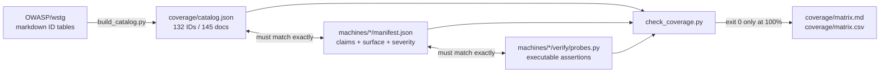

<div align="center">

# wstg-range

**Ten intentionally vulnerable targets that cover 100% of the OWASP Web Security Testing Guide.**

132 test IDs · 145 test documents · 13 categories · 60 containers · every claim backed by an executable probe

[](https://github.com/CharlieZhang0216/wstg-range/actions/workflows/ci.yml)
[](coverage/matrix.md)
[](LICENSE)
[](machines)
[](CONTRIBUTING.md)

**English** · [简体中文](README.zh-CN.md)

</div>

> [!WARNING]
> **Every service in this repository is deliberately insecure.** This is a
> training lab for authorised security testing, education and CTF-style
> practice. All ports bind to `127.0.0.1` only, backend networks are
> `internal: true`, and all data is synthetic. Never deploy it on a shared or
> internet-facing host, and never point it at anything outside its own Compose
> network. See [SECURITY.md](SECURITY.md).

---

## What this is

Most "vulnerable app" projects cover a handful of famous bugs. `wstg-range`
starts from the other end: take the **complete OWASP WSTG test catalogue**, and
build exactly enough targets to exercise every single test — then *prove* each
one is really exploitable.

The result is 10 independent Docker Compose stacks. Each owns a disjoint slice
of the guide, runs real services (not mocks), and ships:

- a **manifest** declaring which WSTG IDs it covers, the vulnerable surface, and severity;
- **executable probes** that assert the weakness is genuinely present;
- a **README that doubles as a training handout** — per-test attack walkthroughs with exact requests and payloads.

Coverage is not a claim in a table. It is a three-way consistency check between
the upstream catalogue, the manifests, and running code, enforced by CI.

## Contents

- [Coverage at a glance](#coverage-at-a-glance)
- [Why 132 and not some other number](#why-132-and-not-some-other-number)
- [Quickstart](#quickstart)
- [The ten machines](#the-ten-machines)
- [How coverage is proven](#how-coverage-is-proven)
- [Verification results](#verification-results)
- [Known limitations](#known-limitations)
- [Safety contract](#safety-contract)
- [Repository layout](#repository-layout)
- [Contributing](#contributing) · [License](#license)

---

## Coverage at a glance

| Category | Tests | Machine |
|---|---:|---|
| Information Gathering (`INFO`) | 10 | [M01](machines/01-recon-config) |
| Configuration & Deployment (`CONF`) | 15 | [M01](machines/01-recon-config) |
| Identity Management (`IDNT`) | 5 | [M02](machines/02-identity-authn) |
| Authentication (`ATHN`) | 14 | [M02](machines/02-identity-authn) |
| Authorization (`ATHZ`) | 5 | [M03](machines/03-authz-session) |
| Session Management (`SESS`) | 11 | [M03](machines/03-authz-session) |
| Injection (`INJT`) | 28 | [M04](machines/04-injection-datastore) · [M05](machines/05-injection-xss-code) · [M06](machines/06-injection-server-protocol) |
| Cryptography (`CRYP`) | 4 | [M07](machines/07-crypto-error) |
| Error Handling (`ERRH`) | 2 | [M07](machines/07-crypto-error) |
| Business Logic (`BUSL`) | 11 | [M08](machines/08-business-logic) |
| Client-side (`CLNT`) | 19 | [M09](machines/09-client-side) |
| API Testing (`APIT`) | 7 | [M10](machines/10-api-wasm) |
| WebAssembly (`WASM`) | 1 | [M10](machines/10-api-wasm) |
| **Total** | **132** | **10 machines** |

Full per-test matrix: [`coverage/matrix.md`](coverage/matrix.md) · [`coverage/matrix.csv`](coverage/matrix.csv)

## Why 132 and not some other number

The denominator is regenerated from the **upstream markdown ID tables**
(`|WSTG-XXXX-NN|`), not from `checklists/checklist.json`. Baseline:

```
repo    https://github.com/OWASP/wstg
branch  master
commit  5bd51b35d4d5c17cb26ff733775c3ac595edcf4b
```

Three upstream quirks that a naive count gets wrong:

| Quirk | How this repo handles it |
|---|---|
| `WSTG-CONF-08` (RIA Cross Domain Policy) and `WSTG-CLNT-08` (Cross Site Flashing) have had their bodies removed upstream — literally *"This content has been removed."* | **Excluded** from the denominator. |
| `WSTG-INJT-13` is claimed by **both** `13-Buffer_Overflow.md` and `13-Format_String_Injection.md` — an upstream ID collision. | Kept as **one ID**, but **both documents must be covered**. M06's single probe demonstrates a real stack canary smash *and* `%p`/`%s`/`%n` format-string exploitation. |
| 12 unnumbered sub-documents hang off parent IDs (`ATHZ-05.1/05.2`, `INJT-05.1–05.8`, `INJT-11.1`, `CLNT-01.1`). | Counted in the **document** denominator (145), not as extra IDs. The parent's probe must exercise every sub-document. |

So: **132 IDs, 145 documents**. Any "100% coverage" claim has to satisfy both.

Regenerate the catalogue yourself:

```bash
git clone --depth 1 https://github.com/OWASP/wstg /tmp/wstg
python3 coverage/build_catalog.py /tmp/wstg
```

`coverage/catalog.json` is a generated artefact — never hand-edit it. CI
regenerates it from upstream and fails if the committed copy drifts.

---

## Quickstart

**Prerequisites:** Docker with Compose v2. ~10 GB of images for all ten machines.

```bash
git clone https://github.com/CharlieZhang0216/wstg-range.git
cd wstg-range

# bring up one machine
cd machines/01-recon-config
docker compose up --build -d
docker compose ps                 # wait until everything is healthy

# prove it is correctly broken
cd ../..
python3 tools/runner.py machines/01-recon-config
```

Expected output:

```
=== 01-recon-config - Reconnaissance & Configuration ===
  [+] WSTG-INFO-01     PASS    ...
  ...
  -> 25/25 passed
```

All ten can run side by side — port blocks do not overlap, and Compose project
names and container names are prefixed `wstg-mNN`.

```bash
# every machine, one venv, all probes
./tools/verify.sh --all

# shut one down (removes volumes too)
cd machines/01-recon-config && docker compose down -v
```

### Parallel development: use per-machine venvs

`tools/verify.sh` uses a shared repo-level `.venv`. If you are building several
machines at once, give each its own to avoid concurrent `pip` conflicts:

```bash
python3 -m venv machines/01-recon-config/verify/.venv
machines/01-recon-config/verify/.venv/bin/pip install -r machines/01-recon-config/verify/requirements.txt
machines/01-recon-config/verify/.venv/bin/python tools/runner.py machines/01-recon-config
```

M09 needs a real browser. Its venv also requires:

```bash
machines/09-client-side/verify/.venv/bin/playwright install chromium
```

### Build-time downloads failing inside containers?

If your `~/.docker/config.json` sets `proxies.default` (e.g.
`http://127.0.0.1:7890`), Docker injects it into every container — where
`127.0.0.1` is the container itself, so `apk` / `apt-get` / `pip` / `npm` all
fail.

Every machine's Compose file carries `x-proxy-args` / `x-proxy-env` anchors that
**blank the proxy** for builds and runtime. If your environment genuinely needs
a proxy, override it per-invocation instead of editing your global Docker config:

```bash
LAB_HTTP_PROXY=http://host.docker.internal:7890 docker compose up --build -d
```

---

## The ten machines

Each directory is independently runnable and has its own training-handout README.

| # | Machine | Ports | Entry point | Tests | Stack highlights |
|---|---|---|---|---:|---|
| M01 | [Recon & Configuration](machines/01-recon-config) | 8100-8199 | `:8100` | 25 | nginx, Apache httpd, Varnish, CoreDNS, LocalStack S3, Redis, Adminer |
| M02 | [Identity & Authentication](machines/02-identity-authn) | 8200-8299 | `:8200` | 19 | Flask portal, **real Keycloak 26** (SAML + OIDC), hand-built WebAuthn RP |
| M03 | [Authorization & Session](machines/03-authz-session) | 8300-8399 | `:8300` | 16 | Multi-role portal, hand-built OAuth2 AS + client, JWT API, in-range attacker origin |
| M04 | [Datastore Injection](machines/04-injection-datastore) | 8400-8499 | `:8400` | 5 (13 docs) | **MySQL 8.4, PostgreSQL 16, MSSQL 2022, MongoDB 7, OpenLDAP 2.6**, ORM, client-side SQL |
| M05 | [XSS & Code Injection](machines/05-injection-xss-code) | 8500-8599 | `:8500` | 10 | Flask/Jinja2/Mako, PHP 8.3, Apache `mod_include`, Node/EJS, nginx WAF |
| M06 | [Server-side & Protocol Injection](machines/06-injection-server-protocol) | 8600-8699 | `:8600` | 13 (14 docs) | **Native C** overflow/format-string, Dovecot IMAP, Mailpit SMTP, CL-framing proxy, Chromium renderer |
| M07 | [Cryptography & Error Handling](machines/07-crypto-error) | 8700-8799 | `:8700` | 6 | Padding oracle, legacy TLS server, Express, cleartext telnet console |
| M08 | [Business Logic](machines/08-business-logic) | 8800-8899 | `:8800` | 11 | Full e-commerce flow, PostgreSQL, in-range mock PSP, PHP upload handler |
| M09 | [Client-side](machines/09-client-side) | 8900-8999 | `:8900` | 19 (20 docs) | aiohttp victim + attacker origins, **real Chromium via Playwright**, TTL-0 rebinding DNS |
| M10 | [API & WebAssembly](machines/10-api-wasm) | 9000-9099 | `:9000` | 8 | REST v1/v2, GraphQL, **real gRPC with reflection**, webhooks, **C→wasm with DWARF** |

All entry points are `http://127.0.0.1:<port>`. Auxiliary services (Keycloak,
gRPC, attacker origins, mock PSP, DNS, weak-TLS, …) are listed in each manifest's
`endpoints` map and each README's port table.

Backend datastores are **not published to the host at all** — they live on
`internal: true` networks and are reachable only through the injection point
that is meant to reach them. That is deliberate.

### Example: what "real" means here

A few probes, to show the bar these targets are held to:

- **M07 / CRYP-02** runs a genuine byte-by-byte padding-oracle attack and
  recovers `FLAG{cbc_oracle}` in 741 requests.
- **M07 / CRYP-04** clones MT19937 state from 312 observed tokens and predicts
  the next one exactly.
- **M06 / INJT-16** desyncs a CL-framing proxy with an obfuscated
  `Transfer-Encoding: xchunked`; the *next innocent request* on the same
  connection receives the smuggled response.
- **M06 / INJT-13** smashes a stack canary with 72 bytes, then a function
  pointer with 100 bytes for a real `SIGSEGV` — and separately leaks stack
  pointers with `%p`, reads memory with `%s`, and writes with `%n`.
- **M09 / CLNT-21** flips a TTL-0 DNS record between two container IPs; real
  Chromium then reads an internal secret **same-origin** and exfiltrates it.
- **M09 / CLNT-05** recovers a secret prefix character-by-character through
  CSS attribute selectors and `url()` callbacks — wrong guesses never fire.
- **M10 / WASM-01** parses a real clang-built `.wasm` binary and recovers an
  embedded API key from its data segments.
- **M08 / BUSL-04** races genuinely parallel threads to redeem a single-use
  coupon twice.

---

## How coverage is proven



```bash
python3 coverage/check_coverage.py
```

The checker enforces:

- required files per machine (`docker-compose.yml`, `manifest.json`, `README.md`, `verify/probes.py`);
- `manifest.machine` equals the directory name; port blocks are valid and **non-overlapping**;
- **every catalogue ID is claimed by exactly one machine** — gaps and double-claims both fail;
- the `docs` set equals the catalogue's, sub-documents included;
- every declared `probe` really exists in `probes.py` (parsed statically with `ast`, never executed);
- every test declares `surface`, `weakness` and `severity`;
- `degraded` entries surface as **warnings**, not failures — they are listed in the final report.

It exits 0 only at 132/132 with zero errors, and writes the matrix.

### The probe contract

```python
def conf_06(ctx):
    r = ctx.session().request("PUT", "/files/probe.txt", data="owned")
    return r.status in (201, 204), f"PUT -> {r.status}"
```

`fn(ctx) -> (bool, evidence)`. **True means the intentional weakness is
demonstrably present** — the lab is correctly broken. It does *not* mean "the
service is up".

`200 OK` alone is never acceptable evidence. A probe must actually read another
user's object, forge a token, recover plaintext, show command output, or measure
a timing delta. Probes are idempotent: they create and reset their own state and
never depend on another probe having run first.

[`tools/labhttp.py`](tools/labhttp.py) is a **stdlib-only** HTTP and raw-socket
client that preserves duplicate headers, allows unusual methods, and supports
`@SECLEVEL=0` TLS — which is what makes request smuggling, response splitting
and IMAP/SMTP injection probeable at the byte level.

---

## Verification results

```
python3 coverage/check_coverage.py
  TOTAL  132/132 ids, 145/145 docs
  PASS: 100% coverage, every declared test has an executable probe
```

All ten machines running simultaneously: **60 containers, all healthy**, every
`docker compose config -q` clean. Each machine's probes were run in its own
isolated venv: **132/132 PASS**, and every machine was run at least twice to
confirm idempotence.

| Machine | Containers | Probes | Degraded |
|---|---:|---:|---:|
| M01 `01-recon-config` | 11 | **25/25** | 2 |
| M02 `02-identity-authn` | 2 | **19/19** | 0 |
| M03 `03-authz-session` | 3 | **16/16** | 0 |
| M04 `04-injection-datastore` | 7 | **5/5** (all 8 dialects) | 1 |
| M05 `05-injection-xss-code` | 7 | **10/10** | 0 |
| M06 `06-injection-server-protocol` | 13 | **13/13** | 1 |
| M07 `07-crypto-error` | 4 | **6/6** | 0 |
| M08 `08-business-logic` | 4 | **11/11** | 0 |
| M09 `09-client-side` | 4 | **19/19** | 0 |
| M10 `10-api-wasm` | 5 | **8/8** | 0 |
| **Total** | **60** | **132/132** | **4** |

Safety audit (the parts CI cannot fully verify, checked by hand): all published
ports bound to `127.0.0.1`; no `privileged`, no `network_mode: host`, no Docker
socket mounts; no `:latest` tags; proxy anchors present in all ten Compose files;
`wstg-mNN-` container naming throughout; warning banner and per-ID walkthrough in
all ten READMEs.

## Known limitations

Four tests are marked `degraded` — faithfully implemented as far as the
environment allows, with the gap stated rather than papered over. **No probe was
weakened to make it pass, and no test was dropped from a manifest.**

| Machine / ID | Limitation | What remains faithful |
|---|---|---|
| M01 `WSTG-INFO-01` | The lab makes no outbound queries, so an in-range search index replaces a public search engine | Dorking syntax (`site:`, `inurl:`, `intitle:`) and the leaked-content outcome |
| M01 `WSTG-CONF-11` | LocalStack's S3 **does not enforce authorization for anonymous requests**, so the private-bucket-403 contrast cannot be shown (`ENFORCE_IAM=1` and an explicit `Deny Principal:"*"` were both tested and ineffective) | Bucket ACL/policy inspection; anonymous read of PII and `.env` |
| M04 `WSTG-INJT-05` | **05.1 Oracle**: `gvenzl/oracle-xe:21-slim` is amd64-only and the engine will not run under arm64/Rosetta. **05.5 MS Access**: no Linux Jet/ACE engine exists | Oracle: faithful mod_plsql/ORDS gateway surface (`/pls/<dad>/<pkg>.<proc>`) backed by PostgreSQL. Access: dialect facade (`IIF`, `TOP`, `*` wildcards, `#date#`, `;` stacking) over real SQLite. **The other six dialects hit real servers**, including MSSQL 2022 running under emulation |
| M06 `WSTG-INJT-21` | No headless Excel available; the spreadsheet client is simulated by an in-range `csv-open` service | Unescaped formula export and `HYPERLINK` exfiltration to an in-range listener are real; DDE commands are recorded, not executed |

Two further details are recorded honestly but are **not** degradations:

- **M07 / CRYP-01** — RC4, 3DES and NULL ciphers are compiled out of modern
  OpenSSL on both ends, so they are reported as *not negotiable*. The test is
  satisfied by genuinely negotiable TLSv1.0/1.1 plus weak CBC/static-RSA suites,
  an expired self-signed CN-mismatched RSA-1024/SHA1 certificate, and absent HSTS.
- **M09 / CLNT-13** — the historical Array-constructor JSON hijack no longer
  fires in modern Chromium (the probe explicitly reports `fired=False`). XSSI
  itself is proven through two real paths: JS-variable disclosure and JSONP.

### Environment notes

Workarounds needed on the reference build host (macOS / arm64 / OrbStack), all
recorded in the relevant machine READMEs:

- Host `python3` is 3.14, which has no `cryptography` / `greenlet` wheels →
  M02 and M09 probe venvs are built with `python3.12`.
- PyPI egress resets / throttling → some venvs installed via a regional mirror;
  the Playwright browser zip was fetched from `cdn.playwright.dev`.
- MCR upstream mirror broken + CDN throttled → the MSSQL image was fetched with
  a parallel-range downloader and `docker load`ed.
- Ten concurrent machines exhausted OrbStack's default /24 IPAM pool → M02 pins
  explicit `10.202.0.0/24` and `10.202.1.0/24` subnets.
- HAProxy normalises or rejects obfuscated `Transfer-Encoding` → M06's smuggling
  target uses a purpose-built CL-framing raw-socket proxy, which produces a real
  CL.TE desync.
- On mirrors where `docker manifest inspect` times out, validate image tags with
  `docker pull -q IMAGE` and check the exit code instead.

---

## Safety contract

[`CONVENTIONS.md`](CONVENTIONS.md) is the binding contract every machine follows:

- **Loopback only** — `"127.0.0.1:8100:80"`, never `0.0.0.0`, never a bare port.
- **Per-machine networks**, backend datastores on `internal: true`.
- **Synthetic data only**, no real credentials or PII.
- **No outbound attacks** — every SSRF/XSS/RFI/exfil target is in-range.
- **Pinned image tags**, healthchecks on every long-running service,
  `restart: "no"`, `wstg-mNN-<service>` container names.
- **No** `network_mode: host`, `privileged`, or Docker socket mounts.
- **Warning banner** at the top of every README.

And the rule that matters most when extending this lab:

> Report honestly. If a probe cannot be made to pass, say so and mark `degraded`
> with the reason — **do not weaken the probe until it passes, and do not delete
> the test from the manifest.**

## Repository layout

```
wstg-range/
├── README.md / README.zh-CN.md
├── CONVENTIONS.md            # the build contract for all 10 machines
├── LICENSE / NOTICE          # MIT code + CC BY-SA 4.0 for the WSTG-derived catalogue
├── SECURITY.md
├── CONTRIBUTING.md
├── coverage/
│   ├── build_catalog.py      # regenerate catalogue from a wstg checkout
│   ├── catalog.json          # generated: 132 IDs / 145 docs — do not hand-edit
│   ├── check_coverage.py     # three-way consistency checker + matrix writer
│   └── matrix.md / matrix.csv
├── tools/
│   ├── labhttp.py            # stdlib-only HTTP + raw-socket client
│   ├── runner.py             # probe executor (waits for health, asserts, reports)
│   └── verify.sh             # shared-venv wrapper
├── machines/
│   ├── 01-recon-config/      # reference implementation
│   │   ├── docker-compose.yml
│   │   ├── manifest.json
│   │   ├── README.md         # training handout: per-ID attack walkthroughs
│   │   ├── verify/probes.py
│   │   └── <service>/        # one dir per built image
│   └── … 02 through 10
└── .github/workflows/ci.yml
```

## Contributing

Contributions are welcome — especially new probes that strengthen existing
tests, and fixes for the four degraded items. Read
[`CONTRIBUTING.md`](CONTRIBUTING.md) first; the short version is:

1. Every WSTG ID belongs to **exactly one** machine. Never double-claim.
2. A probe must demonstrate real impact, not a status code.
3. Probes must be idempotent and stdlib-only where possible.
4. `python3 coverage/check_coverage.py` must exit 0.
5. If you cannot make something faithful, mark it `degraded` — do not weaken it.

## License

- **Code, Dockerfiles, Compose files, probes, tooling and original docs:**
  [MIT](LICENSE).
- **`coverage/catalog.json`** and anything else derived from the OWASP WSTG:
  [CC BY-SA 4.0](https://creativecommons.org/licenses/by-sa/4.0/), with
  attribution to the [OWASP Web Security Testing Guide](https://github.com/OWASP/wstg).
  ShareAlike applies to derivatives of that file.

See [`NOTICE`](NOTICE) for the full split and upstream attribution.

This project is not affiliated with, endorsed by, or sponsored by the OWASP
Foundation.