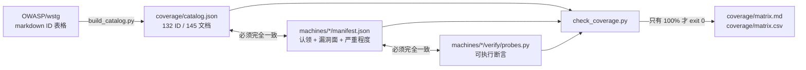

<div align="center">

# wstg-range

**十台故意留漏洞的靶机，覆盖 OWASP Web Security Testing Guide 全部测试项。**

132 个测试 ID · 145 篇测试文档 · 13 个类别 · 60 个容器 · 每一条声明都有可执行探针支撑

[](https://github.com/CharlieZhang0216/wstg-range/actions/workflows/ci.yml)
[](coverage/matrix.md)
[](LICENSE)
[](machines)
[](CONTRIBUTING.md)

[English](README.md) · **简体中文**

</div>

> [!WARNING]
> **本仓库中的全部服务都是故意留漏洞的。** 这是一个用于授权安全测试、教学与
> CTF 式演练的靶场。所有端口只绑定 `127.0.0.1`，后端网络为 `internal: true`，
> 数据全部为合成数据。不要部署在共享或可被公网访问的主机上，也不要让它攻击
> 自身 Compose 网络之外的任何目标。详见 [SECURITY.md](SECURITY.md)。

---

## 这是什么

大多数"漏洞应用"项目只覆盖几个著名漏洞。`wstg-range` 从另一端出发：
先拿到**完整的 OWASP WSTG 测试目录**，再构建恰好足以覆盖每一项测试的靶机，
然后**证明**每一项都真的可利用。

成果是 10 套互相独立的 Docker Compose 栈。每台认领指南中互不重叠的一段，
跑真实服务（不是 mock），并且自带：

- **manifest**：声明覆盖哪些 WSTG ID、漏洞面在哪、严重程度；
- **可执行探针**：断言漏洞确实存在；
- **可直接当训练讲义用的 README**：逐测试的攻击步骤，附确切请求与 payload。

覆盖率不是表格里的声明，而是上游目录、manifest、运行代码之间的三方一致性校验，
由 CI 强制。

## 目录

- [覆盖率总览](#覆盖率总览)
- [为什么是 132 而不是别的数字](#为什么是-132-而不是别的数字)
- [快速开始](#快速开始)
- [十台靶机](#十台靶机)
- [覆盖率是怎么被证明的](#覆盖率是怎么被证明的)
- [验证结果](#验证结果)
- [已知限制](#已知限制)
- [安全契约](#安全契约)
- [仓库结构](#仓库结构)
- [参与贡献](#参与贡献) · [许可证](#许可证)

---

## 覆盖率总览

| 类别 | 测试数 | 靶机 |
|---|---:|---|
| 信息收集 (`INFO`) | 10 | [M01](machines/01-recon-config) |
| 配置与部署 (`CONF`) | 15 | [M01](machines/01-recon-config) |
| 身份管理 (`IDNT`) | 5 | [M02](machines/02-identity-authn) |
| 认证 (`ATHN`) | 14 | [M02](machines/02-identity-authn) |
| 授权 (`ATHZ`) | 5 | [M03](machines/03-authz-session) |
| 会话管理 (`SESS`) | 11 | [M03](machines/03-authz-session) |
| 注入 (`INJT`) | 28 | [M04](machines/04-injection-datastore) · [M05](machines/05-injection-xss-code) · [M06](machines/06-injection-server-protocol) |
| 密码学 (`CRYP`) | 4 | [M07](machines/07-crypto-error) |
| 错误处理 (`ERRH`) | 2 | [M07](machines/07-crypto-error) |
| 业务逻辑 (`BUSL`) | 11 | [M08](machines/08-business-logic) |
| 客户端 (`CLNT`) | 19 | [M09](machines/09-client-side) |
| API 测试 (`APIT`) | 7 | [M10](machines/10-api-wasm) |
| WebAssembly (`WASM`) | 1 | [M10](machines/10-api-wasm) |
| **合计** | **132** | **10 台** |

逐测试完整矩阵：[`coverage/matrix.md`](coverage/matrix.md) · [`coverage/matrix.csv`](coverage/matrix.csv)

## 为什么是 132 而不是别的数字

分母直接从**上游 markdown 的 ID 表格**（`|WSTG-XXXX-NN|`）重新生成，
不依赖 `checklists/checklist.json`。基线：

```
repo    https://github.com/OWASP/wstg
branch  master
commit  5bd51b35d4d5c17cb26ff733775c3ac595edcf4b
```

三个 naive 计数会搞错的上游细节：

| 情况 | 本仓库的处理 |
|---|---|
| `WSTG-CONF-08`（RIA Cross Domain Policy）与 `WSTG-CLNT-08`（Cross Site Flashing）正文已被上游删除——原文就是 *"This content has been removed."* | **排除**，不计入分母 |
| `WSTG-INJT-13` 被 `13-Buffer_Overflow.md` 和 `13-Format_String_Injection.md` **同时占用**——上游 ID 冲突 | 保留 **1 个 ID**，但**两篇文档都必须覆盖**。M06 的单个探针同时演示真实的栈 canary 砸毁与 `%p`/`%s`/`%n` 格式化字符串利用 |
| 12 篇无编号子文档挂在父 ID 下（`ATHZ-05.1/05.2`、`INJT-05.1–05.8`、`INJT-11.1`、`CLNT-01.1`） | 计入**文档**分母（145），不额外增加 ID。父 ID 的探针必须覆盖全部子文档 |

所以：**132 个 ID，145 篇文档**。任何"100% coverage"的说法都必须同时满足这两个数字。

自己重新生成 catalog：

```bash
git clone --depth 1 https://github.com/OWASP/wstg /tmp/wstg
python3 coverage/build_catalog.py /tmp/wstg
```

`coverage/catalog.json` 是生成物，**不要手改**。CI 会从上游重新生成并在提交的副本发生漂移时失败。

---

## 快速开始

**前置：** Docker + Compose v2。十台全量镜像约 10 GB。

```bash
git clone https://github.com/CharlieZhang0216/wstg-range.git
cd wstg-range

# 起一台
cd machines/01-recon-config
docker compose up --build -d
docker compose ps                 # 等到全部 healthy

# 证明它确实"坏对了"
cd ../..
python3 tools/runner.py machines/01-recon-config
```

预期输出：

```
=== 01-recon-config - Reconnaissance & Configuration ===
  [+] WSTG-INFO-01     PASS    ...
  ...
  -> 25/25 passed
```

十台可以同时运行——端口段互不重叠，Compose project 名与容器名都带 `wstg-mNN` 前缀。

```bash
# 全部靶机，一个 venv，所有探针
./tools/verify.sh --all

# 关掉一台（同时清数据卷）
cd machines/01-recon-config && docker compose down -v
```

### 并行开发：用每台自己的 venv

`tools/verify.sh` 用的是仓库级共享 `.venv`。如果你同时构建多台，
给每台独立 venv 以避免并发 `pip` 冲突：

```bash
python3 -m venv machines/01-recon-config/verify/.venv
machines/01-recon-config/verify/.venv/bin/pip install -r machines/01-recon-config/verify/requirements.txt
machines/01-recon-config/verify/.venv/bin/python tools/runner.py machines/01-recon-config
```

M09 需要真实浏览器，它的 venv 还要：

```bash
machines/09-client-side/verify/.venv/bin/playwright install chromium
```

### 容器构建期下载失败？

如果你的 `~/.docker/config.json` 配了 `proxies.default`（例如
`http://127.0.0.1:7890`），Docker 会把它注入每个容器——而容器里的
`127.0.0.1` 是它自己，于是 `apk` / `apt-get` / `pip` / `npm` 全部失败。

每台靶机的 Compose 都带 `x-proxy-args` / `x-proxy-env` 两个锚点，
在构建期与运行期把代理**置空**。如果你的环境确实必须走代理，
按次覆盖，不要改全局 Docker 配置：

```bash
LAB_HTTP_PROXY=http://host.docker.internal:7890 docker compose up --build -d
```

---

## 十台靶机

每个目录都可独立运行，各自带一份训练讲义式 README。

| # | 靶机 | 端口段 | 主入口 | 测试数 | 技术栈亮点 |
|---|---|---|---|---:|---|
| M01 | [侦察与配置](machines/01-recon-config) | 8100-8199 | `:8100` | 25 | nginx、Apache httpd、Varnish、CoreDNS、LocalStack S3、Redis、Adminer |
| M02 | [身份与认证](machines/02-identity-authn) | 8200-8299 | `:8200` | 19 | Flask 门户、**真实 Keycloak 26**（SAML + OIDC）、手写 WebAuthn RP |
| M03 | [授权与会话](machines/03-authz-session) | 8300-8399 | `:8300` | 16 | 多角色门户、手写 OAuth2 AS + client、JWT API、靶场内攻击者源 |
| M04 | [数据存储注入](machines/04-injection-datastore) | 8400-8499 | `:8400` | 5（13 文档） | **MySQL 8.4、PostgreSQL 16、MSSQL 2022、MongoDB 7、OpenLDAP 2.6**、ORM、客户端 SQL |
| M05 | [XSS 与代码注入](machines/05-injection-xss-code) | 8500-8599 | `:8500` | 10 | Flask/Jinja2/Mako、PHP 8.3、Apache `mod_include`、Node/EJS、nginx WAF |
| M06 | [服务端与协议注入](machines/06-injection-server-protocol) | 8600-8699 | `:8600` | 13（14 文档） | **原生 C** 溢出/格式化字符串、Dovecot IMAP、Mailpit SMTP、CL-framing 代理、Chromium 渲染器 |
| M07 | [密码学与错误处理](machines/07-crypto-error) | 8700-8799 | `:8700` | 6 | padding oracle、legacy TLS 服务、Express、明文 telnet 控制台 |
| M08 | [业务逻辑](machines/08-business-logic) | 8800-8899 | `:8800` | 11 | 完整电商流程、PostgreSQL、靶场内 mock PSP、PHP 上传处理 |
| M09 | [客户端](machines/09-client-side) | 8900-8999 | `:8900` | 19（20 文档） | aiohttp 受害源 + 攻击者源、**Playwright 驱动真实 Chromium**、TTL-0 rebinding DNS |
| M10 | [API 与 WebAssembly](machines/10-api-wasm) | 9000-9099 | `:9000` | 8 | REST v1/v2、GraphQL、**真实 gRPC + 反射**、webhook、**C→wasm 带 DWARF** |

主入口均为 `http://127.0.0.1:<端口>`。辅助服务（Keycloak、gRPC、攻击者源、
mock PSP、DNS、弱 TLS 等）列在各自 manifest 的 `endpoints` 与 README 端口表里。

后端数据存储 **完全不对宿主发布**——它们在 `internal: true` 网络上，
只能通过设计上应该打到它们的那个注入点访问。这是故意的。

### 举例："真实"是什么标准

几条探针，用来说明这些靶机被要求达到的门槛：

- **M07 / CRYP-02** 跑真实的逐字节 padding-oracle 攻击，741 次请求解出 `FLAG{cbc_oracle}`。
- **M07 / CRYP-04** 从 312 个观测 token 克隆 MT19937 内部状态，精确预测下一个。
- **M06 / INJT-16** 用混淆的 `Transfer-Encoding: xchunked` 让 CL-framing 代理 desync，
  同一连接上**下一个无辜请求**收到被走私的响应。
- **M06 / INJT-13** 72 字节砸掉栈 canary，100 字节砸掉函数指针触发真实 `SIGSEGV`；
  另外用 `%p` 泄露栈指针、`%s` 读内存、`%n` 写内存。
- **M09 / CLNT-21** 在两个容器 IP 之间翻转 TTL-0 DNS 记录，
  真实 Chromium 随后**同源**读到内部 secret 并外传。
- **M09 / CLNT-05** 通过 CSS 属性选择器 + `url()` 回调逐字符恢复密钥前缀——错误猜测的回调从不触发。
- **M10 / WASM-01** 解析真实 clang 编译的 `.wasm` 二进制，从 data segment 恢复内嵌 API key。
- **M08 / BUSL-04** 用真并发线程把单次券兑换两次。

---

## 覆盖率是怎么被证明的



```bash
python3 coverage/check_coverage.py
```

校验器强制：

- 每台靶机必须有 `docker-compose.yml` / `manifest.json` / `README.md` / `verify/probes.py`；
- `manifest.machine` 等于目录名；端口段合法且**互不重叠**；
- **catalog 里每个 ID 恰好被一台靶机认领**——漏认领、重复认领都失败；
- `docs` 集合与 catalog 完全相等，子文档不能漏；
- 每个声明的 `probe` 在 `probes.py` 里真实存在（用 `ast` 静态解析，不执行）；
- 每条测试必须声明 `surface`、`weakness`、`severity`；
- `degraded` 条目作为**告警**列出，不算失败，但会进入最终报告。

只有 132/132 且零错误时才 exit 0，同时写出矩阵。

### 探针契约

```python
def conf_06(ctx):
    r = ctx.session().request("PUT", "/files/probe.txt", data="owned")
    return r.status in (201, 204), f"PUT -> {r.status}"
```

`fn(ctx) -> (bool, evidence)`。**bool 为真代表"故意留的漏洞确实可被利用"**，
也就是靶机被正确地做坏了——不是"服务活着"。

`200 OK` 本身永远不构成证据。探针必须真的读到别人的对象、伪造出 token、
恢复出明文、给出命令执行输出，或测出时间差。探针必须幂等：
自己造状态、自己复位，绝不依赖别的探针先跑。

[`tools/labhttp.py`](tools/labhttp.py) 是**纯标准库**的 HTTP 与原始 socket 客户端，
保留重复 header、支持异常 method、支持 `@SECLEVEL=0` 的 TLS——
这正是请求走私、响应拆分、IMAP/SMTP 注入能在字节层面被探测的原因。

---

## 验证结果

```
python3 coverage/check_coverage.py
  TOTAL  132/132 ids, 145/145 docs
  PASS: 100% coverage, every declared test has an executable probe
```

十台同时运行：**60 个容器全部 healthy**，`docker compose config -q` 全部通过。
每台用各自独立 venv 实跑探针：**132/132 全部 PASS**，
且每台都至少跑过两次以确认幂等。

| 靶机 | 容器 | 探针 | 降级 |
|---|---:|---:|---:|
| M01 `01-recon-config` | 11 | **25/25** | 2 |
| M02 `02-identity-authn` | 2 | **19/19** | 0 |
| M03 `03-authz-session` | 3 | **16/16** | 0 |
| M04 `04-injection-datastore` | 7 | **5/5**（8 方言全 OK） | 1 |
| M05 `05-injection-xss-code` | 7 | **10/10** | 0 |
| M06 `06-injection-server-protocol` | 13 | **13/13** | 1 |
| M07 `07-crypto-error` | 4 | **6/6** | 0 |
| M08 `08-business-logic` | 4 | **11/11** | 0 |
| M09 `09-client-side` | 4 | **19/19** | 0 |
| M10 `10-api-wasm` | 5 | **8/8** | 0 |
| **合计** | **60** | **132/132** | **4** |

安全审计（CI 无法完全验证、人工核查的部分）：所有发布端口均绑 `127.0.0.1`；
无 `privileged`、无 `network_mode: host`、无 docker socket 挂载；无 `:latest` 标签；
十台 Compose 都带代理锚点；容器名统一 `wstg-mNN-` 前缀；
十份 README 都有警告横幅与逐 ID 攻击步骤。

## 已知限制

四条测试标注为 `degraded`——在环境允许的范围内忠实实现，并明确说明差距，
而不是掩盖。**没有为了让探针通过而削弱断言，也没有把任何测试从 manifest 里删掉。**

| 靶机 / ID | 限制 | 忠实保留的部分 |
|---|---|---|
| M01 `WSTG-INFO-01` | 靶场不做任何外发查询，用范围内搜索索引替代公网搜索引擎 | dorking 语法（`site:`/`inurl:`/`intitle:`）与"搜到泄露内容"的结果 |
| M01 `WSTG-CONF-11` | LocalStack 的 S3 **不对匿名请求做鉴权**，无法演示私有桶返回 403 的对照（`ENFORCE_IAM=1` 与显式 `Deny Principal:"*"` 均实测无效） | 桶 ACL/policy 检查；匿名读到 PII 与 `.env` |
| M04 `WSTG-INJT-05` | **05.1 Oracle**：`gvenzl/oracle-xe:21-slim` 仅 amd64，引擎在 arm64/Rosetta 下无法运行。**05.5 MS Access**：Linux 无 Jet/ACE 引擎 | Oracle：忠实的 mod_plsql/ORDS 网关形态（`/pls/<dad>/<pkg>.<proc>`）backed by PostgreSQL。Access：方言 facade（`IIF`、`TOP`、`*` 通配、`#date#`、`;` 堆叠）over 真实 SQLite。**其余 6 个方言全部打真实服务器**，含模拟环境下真实运行的 MSSQL 2022 |
| M06 `WSTG-INJT-21` | 无 headless Excel，表格客户端由靶场内 `csv-open` 服务模拟 | 未转义公式导出与 `HYPERLINK` 外传到范围内 listener 均为真；DDE 命令只记录不执行 |

另有两处**如实记录但不算降级**的细节：

- **M07 / CRYP-01** — RC4、3DES、NULL 在现代 OpenSSL 两端均已编译移除，
  故记为*不可协商*。该测试由真实可协商的 TLSv1.0/1.1 + 弱 CBC/静态 RSA 套件、
  过期+自签+CN 不匹配的 RSA-1024/SHA1 证书、以及缺失 HSTS 满足。
- **M09 / CLNT-13** — 历史 Array-constructor JSON 劫持在现代 Chromium 已不触发
  （探针明确报 `fired=False`）。XSSI 本身由两条真实路径证明：JS 变量泄露与 JSONP。

### 环境备注

参考构建主机（macOS / arm64 / OrbStack）上需要的绕行，均已记录在对应靶机 README：

- 宿主 `python3` 是 3.14，无 `cryptography` / `greenlet` wheel →
  M02 与 M09 的探针 venv 用 `python3.12` 建。
- PyPI 出口重置/限速 → 部分 venv 经区域镜像安装；
  Playwright 浏览器 zip 从 `cdn.playwright.dev` 取。
- MCR 上游镜像损坏 + CDN 限速 → MSSQL 镜像用并行 range 下载后 `docker load`。
- 十台并发耗尽 OrbStack 默认 /24 IPAM 池 → M02 改用显式
  `10.202.0.0/24` 与 `10.202.1.0/24`。
- HAProxy 会规范化或拒绝混淆的 `Transfer-Encoding` → M06 的走私靶标改用
  专门写的 CL-framing 原始 socket 代理，才做出真实 CL.TE desync。
- 在 `docker manifest inspect` 会超时的镜像源上，
  改用 `docker pull -q IMAGE` 看退出码来验证镜像 tag。

---

## 安全契约

[`CONVENTIONS.md`](CONVENTIONS.md) 是每台靶机都遵守的硬契约：

- **只绑 loopback** — `"127.0.0.1:8100:80"`，绝不 `0.0.0.0`，绝不裸端口。
- **每台独立网络**，后端数据存储 在 `internal: true` 上。
- **只用合成数据**，无真实凭据、无真实 PII。
- **不外发攻击** — 所有 SSRF/XSS/RFI/外传目标都在靶场内。
- **固定镜像 tag**，每个长驻服务都有 healthcheck，
  `restart: "no"`，容器名 `wstg-mNN-<service>`。
- **禁止** `network_mode: host`、`privileged`、docker socket 挂载。
- 每份 README 顶部都有**警告横幅**。

以及扩展本靶场时最重要的一条：

> 如实报告。如果某个探针无法通过，说明原因并标注 `degraded`——
> **不要为了让它通过而削弱探针，也不要把这条测试从 manifest 里删掉。**

## 仓库结构

```
wstg-range/
├── README.md / README.zh-CN.md
├── CONVENTIONS.md            # 10 台靶机共同遵守的构建契约
├── LICENSE / NOTICE          # 代码 MIT + WSTG 派生目录 CC BY-SA 4.0
├── SECURITY.md
├── CONTRIBUTING.md
├── coverage/
│   ├── build_catalog.py      # 从 wstg checkout 重新生成 catalog
│   ├── catalog.json          # 生成物：132 ID / 145 文档，勿手改
│   ├── check_coverage.py     # 三方一致性校验器 + 矩阵生成
│   └── matrix.md / matrix.csv
├── tools/
│   ├── labhttp.py            # 纯标准库 HTTP + 原始 socket 客户端
│   ├── runner.py             # 探针执行器（等待 healthy、断言、出报告）
│   └── verify.sh             # 共享 venv 包装脚本
├── machines/
│   ├── 01-recon-config/      # 参考实现
│   │   ├── docker-compose.yml
│   │   ├── manifest.json
│   │   ├── README.md         # 训练讲义：逐 ID 攻击步骤
│   │   ├── verify/probes.py
│   │   └── <service>/        # 每个构建镜像一个目录
│   └── … 02 到 10
└── .github/workflows/ci.yml
```

## 参与贡献

欢迎贡献——尤其是强化现有测试的新探针，以及修复那四条降级项。
先读 [`CONTRIBUTING.md`](CONTRIBUTING.md)，简版：

1. 每个 WSTG ID 属于**恰好一台**靶机，绝不重复认领。
2. 探针必须证明真实影响，不是状态码。
3. 探针必须幂等，尽可能只用标准库。
4. `python3 coverage/check_coverage.py` 必须 exit 0。
5. 做不到忠实实现就标 `degraded`，不要削弱它。

## 许可证

- **代码、Dockerfile、Compose、探针、工具与原创文档：** [MIT](LICENSE)。
- **`coverage/catalog.json`** 及其他从 OWASP WSTG 派生的内容：
  [CC BY-SA 4.0](https://creativecommons.org/licenses/by-sa/4.0/)，
  署名 [OWASP Web Security Testing Guide](https://github.com/OWASP/wstg)。
  该文件的衍生作品适用 ShareAlike。

完整划分与上游署名见 [`NOTICE`](NOTICE)。

本项目与 OWASP 基金会无隶属、背书或赞助关系。